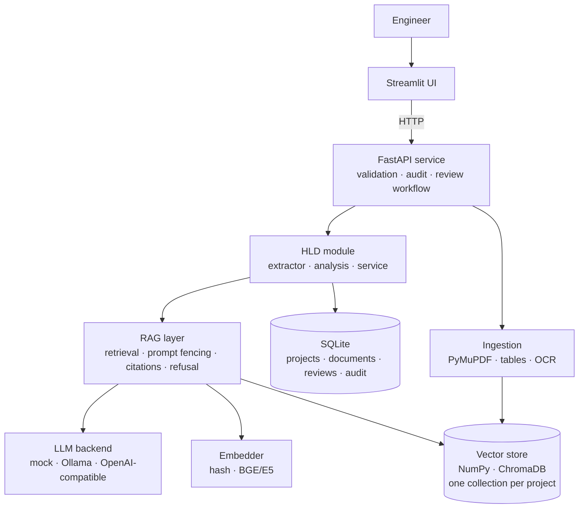

# Automotive Engineering AI Platform

An AI-assisted engineering platform for automotive software teams, built on a shared
**RAG core** (local vector store, pluggable LLM, citations, audit, human review) with
one module per case study:

| # | Module | Status |
|---|--------|--------|
| 1 | **AUTOSAR HLD Document Analysis** | ✅ Implemented (Stage 1) |
| 2 | **Functional Safety HARA & safety requirements** | ✅ Implemented (Stage 2) |
| 3 | **Cybersecurity TARA** | ✅ Implemented (Stage 2) |
| 4 | **UDS diagnostics & test generation** | ✅ Implemented (Stage 3) |
| 5 | **Secure code debugging & review** | ✅ Implemented (Stage 4) |
| 6 | **Vulnerability monitoring & OTA update security** | ✅ Implemented (Phase 2) |
| 7 | **ADAS virtual validation (AEB, model- and software-in-the-loop)** | ✅ Implemented (Phase 4) |
| 8 | **Release readiness, engineering agent and enterprise integration** | ✅ Implemented (Phase 5) |
| 9 | **Field-issue investigator: agentic root-cause analysis of customer complaints** | ✅ Implemented (Phase 6, own case study) |
| 10 | **CarSaathi: the car-owner app (garage, papers, reminders, family sharing; web, PWA, Android)** | ✅ Implemented (Phase A) |
| 11 | **CarSaathi help: car problems in the owner's words, safety first, reports to the field-issue investigator** | ✅ Implemented (Phase B) |
| 12 | **CarSaathi car health and running costs: OBD-II over Bluetooth, fault codes in plain words, real mileage, cost per km** | ✅ Implemented (Phase C) |
| 13 | **CarSaathi notifications and service booking: reminder emails, push to phones and browsers, workshops answer through a private link** | ✅ Implemented (Phase D) |

**Phase 1 – measured AI quality** (new): hybrid BM25 + vector retrieval, off-topic refusal before
the LLM is called, duplicate-version handling, citation support checks, LLM fallback, and a
79-question evaluation that runs locally, on the *AI Quality* page and as a CI gate.
On the offline setup, overall accuracy went from **46.8% to 79.7%** and off-topic questions refused
from **0% to 100%** (details: [docs/PHASE1_AI_QUALITY.md](docs/PHASE1_AI_QUALITY.md),
[eval/results/REPORT.md](eval/results/REPORT.md)). Live demo deployment:
[docs/DEPLOY_RENDER.md](docs/DEPLOY_RENDER.md).

**Phase 2 – OTA update security and R155/R156 evidence** (new): CycloneDX SBOMs per ECU matched
against an OSV advisory feed (CVSS computed from the vector, VEX triage with four-eyes, exploitable
findings flag the ECU's TARA threats, CycloneDX VEX export); signed OTA packages (ECDSA P-256)
verified by 12 checks including anti-rollback, replay, RXSWIN and SBOM delta, released only by a
second person, with an attack self-test that catches **17/17** tampering scenarios; and a CSMS/SUMS
evidence pack organised by the UN R155 Annex 5 threat groups. Details:
[docs/PHASE2_OTA_CYBERSECURITY.md](docs/PHASE2_OTA_CYBERSECURITY.md).

**Phase 4 – ADAS virtual validation with software-in-the-loop** (new): an Autonomous Emergency
Braking function as a Python reference model **and** production-style C code (0 findings from the
platform's own analyzer), tested in a closed-loop simulation on 52 Euro NCAP-style and SOTIF
scenarios against 15 machine-checkable requirements. The C code is compiled and run in the loop,
compared **back-to-back** with the model (0 differences over 50,000+ time steps) and stress-tested
with **mutation testing** (7 of 11 injected defects caught by the requirements, all survivors caught
by back-to-back). Boundary-value analysis and plain-language descriptions propose new scenarios for a
reviewer; scenarios export to **ASAM OpenSCENARIO 1.1**; a release needs a second person and fresh
SIL evidence, and changing a requirement makes the release suspect. Details:
[docs/PHASE4_ADAS_VIRTUAL_VALIDATION.md](docs/PHASE4_ADAS_VIRTUAL_VALIDATION.md).

**Phase 5 – agentic engineering workflows and enterprise integration** (new): one **GO / NO-GO release
readiness** view across all disciplines (eleven checks; twelve with Phase 6), with an owner and an action for every blocker (also as a CI
gate); an **engineering agent** that turns a goal into a plan (rule playbooks, or an LLM choosing from the same
tool registry), runs read steps on its own and **stops for a person before every write**, which then runs under
that person's name so four-eyes still holds; it has no tool that can approve, release or delete, and resumes
waiting runs by deterministic replay. Integration: **signed webhooks** fed from the tamper-evident audit log
(SSRF-protected, retries, dead letter), **Jira** tickets, **ReqIF 1.2** exchange with OEM/supplier tools
(XSD-valid export; import with change detection that flags the platform items a customer change affects), an
**MCP server** so AI assistants can use the platform with a user's own permissions, and hardened **Kubernetes**
manifests. Details: [docs/PHASE5_AGENTIC_INTEGRATION.md](docs/PHASE5_AGENTIC_INTEGRATION.md).

**Phase 6 – field-issue investigator** (new, own case study): when customers complain that the car *braked for no
reason*, the agent investigates on its own as soon as the complaint arrives. It groups complaints by symptom and software
build, **replays each vehicle recording bit-exactly on the field build's compiled C code**, rebuilds the situation as a
closed-loop scenario (retrying variations until it matches), and finds the root cause by differential replay: a coding
defect (code vs model), a calibration regression (and which parameter), a radar phantom, a correct intervention (without
AEB the car would have crashed), a system limitation or missing data. It then checks why the problem escaped, searches a
fix that passes every complaint, a margin case and the whole regression library (or a rollback build), proposes the
hazard rating and the corrective actions, and **stops for a person twice** (safety manager, actions); scenario approval,
the verification campaign's release and the closure stay four-eyes. Output: tickets, regression scenarios, a verified
calibration and a complete **8D report**. Measured on 27 labelled cases (synthetic): root cause 27/27, no false defects
(CI gate). Details: [docs/PHASE6_FIELD_ISSUE_INVESTIGATOR.md](docs/PHASE6_FIELD_ISSUE_INVESTIGATOR.md).

**Phase A – CarSaathi, the car-owner app** (new): a separate product for the people who drive the cars. Owners sign in with
an emailed code (no password), keep their cars under their number plates, photograph their RC, insurance and PUC into a
document vault that tracks expiry, and get service reminders by date, by kilometres or both. A car can be shared with family
as owner or driver; a one-tap demo gives every visitor a private sandbox. Mobile-first React app, installable as a PWA, and
an **Android app built by GitHub Actions** (Capacitor wrapper around the live site, the same way as the PlanetU ERP app);
FastAPI with **PostgreSQL** (Neon) on Render. Hashed codes and tokens, object-level access checks, content-typed uploads,
strict CSP, DPDP export and erasure. Details: [docs/PHASE_A_OWNER_APP.md](docs/PHASE_A_OWNER_APP.md).

**Phase B – help with car problems** (new): owners describe the problem in their own words, in English or Hinglish
("bluetooth connect nahi ho raha", "flyover pe achanak brake lag gaya"). A **safety check runs first** (brakes, smoke,
fuel smell, steering, overheating, a stuck accelerator: what to do now, with 112, the car's roadside number and NHAI 1033),
then a search over **26 step-by-step guides** (Bluetooth and calls, music, Android Auto and CarPlay, screen, cameras,
ADAS, keys, battery, tyres, EV charging) and **16 warning lights** shown as an instrument cluster. An optional LLM may only
pick an existing guide. When nothing helps, a **help request** carries the steps tried, answers and photos to the service
centre. For ADAS problems the owner can, with consent, send an **anonymised report to the Phase 6 field-issue
investigator**, where it joins the dealer complaints for that build and starts the agent's investigation. Measured on 210
labelled descriptions: right guide first for 90.3% of an untouched held-out set (top 3: 100%), every urgent description
gets its safety card, no false alarms (CI gate). Details: [docs/PHASE_B_OWNER_HELP.md](docs/PHASE_B_OWNER_HELP.md).

**Phase C – car health and running costs** (new): a **₹500 Bluetooth OBD-II adapter** in the port under the dashboard,
and the phone reads the car's own diagnostics: engine light, stored, pending and permanent fault codes, battery and
charging voltage, coolant temperature. The phone only relays twelve read-only ELM327 commands; the **server decodes** the
raw answers (CAN multi-frame, older protocols, echo, several control units) and explains **95 common fault codes in plain
language** with whether it's safe to drive. Works in the Android app (Capacitor Bluetooth LE) and Chrome (Web Bluetooth),
with a demo adapter and typed-in codes as alternatives. A **fuel and charging log** gives the real full-to-full mileage,
cost per km, spend by month and kind of cost (CSV export) and flags a mileage drop; the odometer history gives km per day,
so km-based reminders get a date. One status per car, Good / Check soon / Needs attention, lists every reason with a next
step. Details: [docs/PHASE_C_CAR_HEALTH_COSTS.md](docs/PHASE_C_CAR_HEALTH_COSTS.md).

**Phase D – notifications and service booking** (new): a **daily run** (started at 9:00 IST by GitHub Actions, so a
sleeping free instance still works) tells each person, **once per stage**, about papers expiring (30, 7 and 1 days, on the
day, then weekly), services due by date or by the day the km will be reached, red health checks and booking updates. It
goes to an **in-app inbox**, a daily **email digest** with one-click unsubscribe, and **Web Push** to phones and browsers,
implemented from the RFCs (8291 encryption, 8292 VAPID) and checked against the RFC's worked example. The Android app
schedules the coming weeks on the phone. **Service booking** starts from a due reminder, a fault code or a help request;
the workshop answers on a **private link with no account** (a 192-bit token kept in the URL fragment, hashed in the
database): confirm or offer a time, estimate, received, ready. When the service is done, the bill lands in Costs and the
reminders move to their next date and km. Details: [docs/PHASE_D_NOTIFICATIONS_BOOKING.md](docs/PHASE_D_NOTIFICATIONS_BOOKING.md).

> AI output is advisory. Nothing is used for design approval, compliance or release
> without qualified human review. The platform enforces this in the workflow (see *Design decisions*).

## What the HLD module does

- **Controlled ingestion** of PDF / Markdown / text HLDs: type + size validation, SHA-256 de-duplication, version labels, `approved`/`draft` status, optional OCR for scanned pages.
- **Table-aware PDF parsing**: port tables stay attached to the right section (PyMuPDF), so extraction from a PDF equals extraction from the source Markdown (covered by tests).
- **Cited Q&A**: answers carry `[S#]` labels mapped to document, version, page and section. The pipeline **refuses** when evidence is weak instead of guessing.
- **Structured extraction**: components, ports (P/R direction), port interfaces, data elements, signals, runnables, with page-level source references.
- **Dependency graph** (provider → consumer) and **impact analysis** (what breaks downstream if a component changes).
- **Consistency checks** (12 rules, e.g. undefined interface, missing provider, port naming vs direction mismatch, duplicate definitions, interface without type). Findings go to a **review queue**; reviewers mark them *confirmed* or *false positive*, which yields a live precision metric.
- **Revision comparison** (added/removed/changed components, interfaces, ports and which issues were resolved or introduced).
- **Export** to JSON / CSV, **audit log** of every action, **project isolation** (one vector collection per project).

## What the HARA module does (Functional Safety)

Pipeline: **item definition → hazard suggestions → hazardous events → guided S/E/C → deterministic ASIL → safety goals → FSR/TSR drafts → allocation + verification → traceability, completeness, report.**

- **Hazard suggestions** from guidewords × functions, enriched with *similar approved hazards* retrieved from a hazard library (vector search). The library is versioned data with owner and review date; the bundled one is synthetic.
- **Guided assessment**: severity, exposure and controllability each need a **written rationale**. The **ASIL is computed by a rule table, never by the LLM** (`app/modules/hara/rules.py`, `RULESET_VERSION`). Library values are shown as suggestions; the tool records whether the engineer adopted them.
- **Safety goals** are derived from approved events (grouped by function and failure mode, highest ASIL wins). A goal cannot be approved without a safe state and an FTTI.
- **FSR/TSR drafts** from templates with deliberate placeholders (`[FTTI_ms]`, `[SAFE_STATE]`, `[MONITORED_SIGNAL]`). A **requirement quality checker** (shall/atomicity/vague words/placeholders/measurability) **blocks approval** while errors remain.
- **Allocation is validated** against the components extracted from a linked Stage-1 HLD, and every requirement needs a verification reference before approval.
- **Change impact**: reassessing an approved event (e.g. ASIL D → QM) marks its goal and all FSR/TSR **suspect** and records why; goals whose events no longer support them are flagged as orphaned.
- **Completeness**: an 11-point checklist plus a *traceability completeness* percentage over mandatory links; **trace matrix**; Markdown/JSON/CSV **report with approval evidence**.
- **Four-eyes approval** and a **revision history** (who changed what, when) on every record.

## What the TARA module does (Cybersecurity)

Pipeline: **architecture → assets → attack surface / trust boundaries → threat scenarios → impact + attack potential → risk value → treatment → cybersecurity goals → controls/requirements → coverage checklist → traceability.**

- **Inputs**: architecture JSON, **communication-matrix CSV** import (size/row limits, strict validation) or components/flows imported from a Stage-1 HLD; merging never overwrites curated fields.
- **Attack surface map** by interface (CAN, LIN, Ethernet, OBD, USB, Bluetooth/WiFi, cellular/OTA, backend) with exposure class, plus **trust-boundary crossings** between zones.
- **Threat scenarios from an approved library** (STRIDE, damage scenario, high-level attack path, control mapping). Every entry has owner, review date and source; entries **past their review date are flagged** and block the completeness check.
- **Guided risk assessment**: impact per category (safety/financial/operational/privacy) and the five attack-potential factors are chosen by the engineer with a written rationale; **feasibility and risk value are computed by rules** (`app/modules/tara/rules.py`). Optional link to an approved HARA event warns when the TARA safety impact undersells the HARA severity.
- **Treatment**: high risks must be reduced/avoided/shared, or retained with a justification **and a second person's risk acceptance**.
- **Goals and control recommendations** with **source, assumptions and alternatives** on every recommendation; requirement templates carry placeholders that must be resolved before approval.
- **Coverage checklist** (interface × STRIDE) with engineer-justified, approved *not applicable* declarations. The report states explicitly that checklist coverage is not proof of completeness and that expert (red-team) review is required for novel threats.
- Same suspect-propagation, four-eyes, history, trace matrix, metrics (knowledge reuse, acceptance, cycle time, coverage) and report export as HARA.

### Rule sets you must verify

The ASIL table, the attack-potential values, the feasibility thresholds and the risk matrix are implemented as **explicit, versioned example rule sets** (`example-additive-v1`, `example-attack-potential-v1`). They follow the structure of the published methods but you must **check them against your licensed ISO 26262 / ISO/SAE 21434 copy and your organisation's approved method** and change the tables in `rules.py` if they differ. The hazard and threat libraries are **synthetic training data**, not real project knowledge.

## What the UDS module does (Diagnostics)

Pipeline: **diagnostic spec → consistency checks → response oracle → request validation → test generation → review → coverage → simulator → Python/CAPL export.**

- **Specification model** (sessions, security levels, services, DIDs, routines, DTCs, timing) built from a JSON file or **extracted from a Markdown/PDF spec document** (table-aware, same parser as the HLD module; the extraction of the sample spec equals a golden JSON in tests). **Ten consistency rules** on the spec itself (duplicate DIDs, undefined security levels, writable DID without security, DIDs defined but service 0x22 not declared, unmodelled services ...). A spec with errors cannot be approved.
- **One deterministic response oracle** (`engine.py`) predicts the ECU response to any request in any state: NRC 0x11/0x12/0x13/0x24/0x31/0x33/0x35/0x36/0x37/0x7E/0x7F, suppress-positive-response, session changes that lock security access, seed/key sequences with attempt limits and delay, DID and routine rules, write range checks, S3 timeout. The **check order is documented in the file** so it can be aligned with an OEM specification. The LLM never decides an expected result.
- **Request validation**: send one or a sequence of requests (`<KEY>` / `<BADKEY>` markers for key material) and get the expected response, the rule that fired and a plain-language reason.
- **Test generation**: positive, negative, boundary, session, security and timing tests are enumerated from the spec and the **oracle computes every expected result**, so expectations cannot drift from the validation rules. About 118 tests for the sample BCM spec (unlock and lock-out, wrong key, range boundaries, length ±1, session-denied, S3 timeout, TesterPresent keep-alive ...).
- **Review workflow**: tests are proposed, then approved by a second person; tests cannot be approved until the spec is approved. When the spec changes, regenerating **marks changed tests and tests for removed elements suspect** with the reason.
- **Coverage**: every spec element needs a positive and a negative test (attributed by the requests actually sent), plus an **NRC coverage** view (applicable vs exercised).
- **Simulator with fault injection**: a simulated ECU runs the tests without hardware. Seven injectable defects (ignored session restrictions, no security, accept any key, wrong NRC for length errors, ignored suppress bit, no range check, no attempt limit) are **each detected** by the generated suite (asserted in tests), and the correct implementation passes all tests.
- **Export**: a **pytest bundle** (generated tests + standalone stdlib-only `uds_harness.py` + `conftest.py`) and CSV/JSON; an **experimental CAPL** template. Only approved tests are exported unless you ask for a draft. The exported pytest bundle is executed in the test-suite against the simulator (passes on a correct ECU, fails on injected defects).
- **Cross-module traceability**: a test can be attached as verification evidence to a HARA FSR/TSR or a TARA cybersecurity requirement. The shared graph then links hazardous event → goal → requirement → test, so re-assessing the event flags the test evidence for review.
- **Cited Q&A** over the specification document, reusing the shared RAG core.

**What this does not prove:** the simulator shares the oracle with the generator, so passing tests show that the suite and the exported code are consistent and can detect deviations, **not that the specification or the oracle rules are correct**. Verify the oracle's check order and NRC choices against your OEM diagnostic specification (ISO 14229 leaves some choices to the OEM). The CAPL file and the `SocketCanEcu` adapter were **not compiled/run against CANoe or a real bus** here.

## What the code review module does (Secure code review)

Pipeline: **C sources + static-analysis logs → rule analysis → corroboration → findings lifecycle → triage → verified fix proposals → gate / SARIF.**

- **Built-in analyzer** (`analyzer.py`, dependency-free): 28 rules over a comment- and string-masked token stream with brace matching. Security (unbounded string functions, `gets`, format strings, shell execution, use-after-free/double free, hard-coded credentials and keys, allocation-size overflow, off-by-one loops, wrong `sizeof`, TOCTOU, weak temp/random), robustness (unchecked allocation, uninitialised variables) and safety/MISRA-style checks (goto, recursion, `switch` without default, fall-through, assignment in condition, missing braces, unreachable code, **ISR-shared variables that are not `volatile`**, complexity). Every rule has an original description, a fix hint, a CWE, a CERT C id where one exists and an informational MISRA-style number. Each rule has a positive test and a false-positive guard.
- **Static-analysis log ingestion**: cppcheck XML, SARIF 2.1.0 and compiler-style text (DOCTYPE/ENTITY XML is rejected). Tool findings are matched to sources and **corroborated** against rule findings by line and CWE instead of being duplicated. A **log older than the source revision is ignored as stale**.
- **Findings lifecycle**: every finding has a fingerprint (rule + file + function + normalised code, comments ignored), so **triage decisions survive line shifts and new revisions**; findings that disappear are marked *fixed*, and fixed ones that come back are *reopened* as regressions.
- **Triage with accountability**: confirm, false positive or waive, each with a justification. For **critical/high findings a false-positive or waiver needs a second person** (four-eyes). Reviewer decisions produce a live **precision per rule and per origin**, so noisy rules can be tuned or dropped.
- **Verified fix proposals**: for the rules where a mechanical fix is safe (`gets`, `strcpy`/`strcat`/`sprintf`, non-literal format, double free, off-by-one, missing `default`, missing braces, unchecked allocation) the module produces a unified diff **and re-analyses the patched code**: the finding must disappear and nothing new may appear. Nothing is changed automatically.
- **Optional LLM review (off by default)**: the model must return JSON in which every item **quotes the exact line** it refers to; items whose evidence does not match the code are dropped as fabricated, severity is capped at *high*, CWE ids are validated, and results are marked low confidence and never auto-fixed. Source is sent as fenced **untrusted data**, secrets and key material are **redacted before sending**, and a non-local backend requires an explicit `allow_external` confirmation. A comment that tries to address an AI reviewer is itself flagged (rule CR029).
- **Automotive context**: link an HLD so functions map to components; findings in components with HARA-allocated requirements carry the **highest ASIL** and are counted as safety-relevant. A finding can be linked to the requirement it undermines (shared traceability graph).
- **Quality gate and CI**: `GET /gate?fail_on=high` and an offline CLI, `python scripts/review_gate.py src/ --fail-on high --format sarif`, that exits non-zero on blockers and emits **SARIF** for GitHub code scanning. Reports as Markdown, CSV, JSON and SARIF (waived and false-positive findings are exported as suppressions).

**Honest scope:** this is a heuristic analyzer without a compiler front end, type information or data-flow engine, so it produces false positives and misses things a certified tool would catch. It is **not a MISRA compliance checker**: rule text is original, MISRA numbers are informational and must be verified against your licensed copy. Use it to complement, not replace, a qualified static analyzer and human review.

## Security, operations and deployment (Stage 5)

### Authentication and access control
`AUTH_MODE=off` (the default) is a **development mode**: the `X-User` header is trusted, so anybody can claim any identity, and there is no access control. **Use `AUTH_MODE=enforced` for anything shared.** In that mode:

- **Identity is bound to an API token** (`Authorization: Bearer ...`). The `X-User` header is ignored, so the **four-eyes approvals of Stages 2-4 can no longer be bypassed by claiming another name** (asserted in tests: a reviewer who sends `X-User: bob` is still blocked from approving their own assessment). Tokens are 256-bit random values shown once; only their SHA-256 is stored; they expire (`TOKEN_TTL_DAYS`), can be rotated and disabled. Tokens in query strings are never accepted.
- **Per-project roles**: `viewer` (read) < `engineer` (create, edit, generate, analyze) < `reviewer` (approve decisions, load knowledge libraries, view the audit log) < `admin` (manage members, delete). Platform role `admin` manages users and sees all projects; a user who creates a project administers it. Non-members receive **404**, so a project's existence is not revealed.
- **Deny by default**: every request is classified from its method and path; anything not recognised as a read needs at least `write`. A test enumerates **every route in the OpenAPI schema** so a new endpoint cannot silently be more open than intended, and asserts exactly which POSTs are read-only (queries, validation, simulation).
- **Hardening**: per-user rate limit and a lockout for repeated failed logins per client address (429 + `Retry-After`), request-size limit that also covers **chunked uploads**, security headers, request IDs (sanitised), and generic 500 responses (no stack traces or paths to the client; details go to the log). Denied and failed requests are audited; presented tokens are never logged or stored (asserted).
- **Bootstrap**: the first start creates the `admin` user from `ADMIN_TOKEN`, or generates a token and prints it once. `python scripts/manage.py create-user|rotate|disable|grant ...` manages users offline. Configuration is validated at start (`manage.py check-config`); a too-short admin token or an unknown mode refuses to start.

### Tamper-evident audit log
Each audit row commits to the previous one (SHA-256 chain, written under `BEGIN IMMEDIATE`). `GET /admin/audit/verify` (or `manage.py verify-audit`, exit code 1 on failure) detects **edited, deleted and injected rows**. Rows written before Stage 5 are reported as *legacy* (cannot be verified). A chain proves internal consistency; **truncating the newest entries is only detectable if you record the head hash outside this system** (`/admin/audit/verify` returns it), so anchor it periodically in a ticket or write-once storage.

### Observability
Structured logs (`LOG_FORMAT=json`) with request ID, user, route template, status and latency; `GET /metrics` (admin only) in Prometheus format: request counts and latency histograms by **route template** (low cardinality), authentication and rate-limit events, LLM call counts/latency/errors, users, records and audit rows; `GET /ready` (database, writable storage, embedder; 503 when not ready) and `GET /health` (anonymous callers see only `status` and `auth`); `GET /system/info` (admin) lists limits and configuration warnings, e.g. that a non-local LLM sends prompts off the machine.

### Operations
- **Schema migrations** are numbered and idempotent (`schema_version`); a Stage 1-4 database is upgraded in place (tested on a database built with the old schema).
- **Backup and restore** (`manage.py backup|restore`): consistent SQLite snapshot (online backup API) plus uploads, parsed text and vector files with a SHA-256 manifest. Restore refuses path traversal, absolute paths, links, missing or extra files and any integrity mismatch, never overwrites existing data without `--force` (the old data is kept), then re-runs migrations and audit verification. Backups are `0600`; **encrypt them at rest yourself**.
- **Reindex** (`manage.py reindex`) rebuilds vector collections from stored text, e.g. after changing the embedding model or restoring without a consistent vector copy.
- **Packaging**: unprivileged container user, read-only root filesystem, dropped capabilities, health checks, JSON logs, ports bound to localhost by default. Put a **TLS-terminating reverse proxy** in front (the app does not terminate TLS) and set uvicorn's `--forwarded-allow-ips` to the proxy so per-client limits see real addresses. **The Docker files and the CI `docker` job were not built or run in the development sandbox**: run `docker compose config` and a smoke test first.

### Cross-module traceability (UI page *Traceability*, API `/projects/{p}/trace/...`)
One graph links hazards, events, goals, requirements, threats, tests, code findings and architecture elements. `GET .../trace/nodes/{ref}` returns everything upstream and downstream of any item with module, status and hop count; `GET .../trace/suspect` is the **worklist of everything in any module that needs re-review** after an upstream change; `summary` lists requirements without verification, allocation or with open code-review findings; `graph?around=REF` renders the neighbourhood (suspect nodes highlighted).

### What this does not do (read before deploying)
- **No SSO/OIDC or MFA**: authentication is by API token. In an enterprise, put the service behind your identity-aware gateway and map identities to tokens; Streamlit keeps the token in the browser session.
- **Single process**: SQLite, the in-memory rate limiter and the audit chain assume one server process. For several workers or high availability move to PostgreSQL and a shared limiter.
- **No encryption at rest and no per-project cryptographic isolation**: use disk/volume encryption; isolation between projects is enforced by application checks and separate vector collections.
- **RBAC is only as strong as its deployment**: whoever has file access to the data directory or the database can bypass it. The audit chain makes tampering detectable, not impossible.
- **Rule sets, libraries and the UDS oracle still need domain review** (Stages 2-4). The default `mock` LLM is not a language model.

## Architecture



```
app/
  config.py            env-driven settings
  container.py         wires shared services (modules plug in here)
  core/                llm · embeddings · vectorstore · parsing · chunking · rag · documents · db
                       trace (traceability graph) · workflow (four-eyes, suspect propagation) · reqquality
                       auth (tokens, roles, limiter) · observability (logs, metrics) · maintenance (backup, restore, reindex) · tracequery
  modules/hld/         extractor · analysis · service
  modules/hara/        rules (ASIL) · templates · service
  modules/tara/        rules (risk) · architecture · service
  modules/uds/         spec · engine (oracle) · testgen · simulator · harness_template · export · service   
  modules/codereview/  analyzer (28 rules) · logs · fixes · sarif · service
  modules/vuln/        sbom (CycloneDX) · feed (OSV) · versions · cvss · service (findings, VEX, TARA link)
  modules/ota/         package (format, ECDSA P-256) · checks (P01-P12) · selftest (17 attacks) · service
  modules/compliance/  r155 (Annex 5 groups, mapping) · service (evidence pack)
  modules/adas/        model (AEB reference) · sim (closed loop) · scenarios (catalog, OpenSCENARIO) · requirements
                       authoring (validation, boundary values, plain language) · sil (C build + ctypes) · campaign
                       (verdicts, back-to-back, mutation testing) · report · service (workflow, release)
  modules/readiness/   release readiness (GO / NO-GO across all modules, owners and actions)
  modules/agent/       tools (allow-listed registry) · playbooks (plans, router, LLM planner) · service (checkpoints, replay, audit)
  modules/integration/ webhooks (events, SSRF policy, signing) · jira · reqif (1.2 export/import) · service (dispatch, tickets, change impact)
  modules/field/       logs (recordings) · builds · investigate (replay, reconstruction, diagnosis, escape, fix search, hazard) · triage · service · report (8D)
firmware/aeb/          aeb_ctrl.c / aeb_ctrl.h: the AEB function in C99 (software under test)
deploy/k8s/            Kubernetes manifests (kustomize; hardened; validated with kubeconform)
  api/                 main · hld routes · hara · tara · uds · codereview · vuln · ota · compliance · adas · agent · integration · admin · trace · security (guard/RBAC) · deps
ui/streamlit_app.py    HLD page (main)
ui/pages/              2_Functional_Safety_HARA.py · 3_Cybersecurity_TARA.py · 4_UDS_Diagnostics.py · 5_Secure_Code_Review.py · 6_Traceability.py · 7_Administration.py
                       8_AI_Quality.py · 9_Vulnerabilities_and_OTA.py · 10_ADAS_Virtual_Validation.py
                       11_Release_Readiness_and_Agent.py · 12_Integrations.py · 13_Field_Issues.py
scripts/               manage.py (users, backup/restore, reindex, verify-audit) · review_gate.py (CI) · seed_demo.py
                       run_eval.py (RAG evaluation) · ota_tool.py (keys, signed packages) · sil_run.py (SIL campaigns, CI gate)
                       mcp_server.py (MCP for AI assistants) · release_gate.py (GO / NO-GO gate for external pipelines)
                       make_field_data.py (synthetic field recordings) · eval_field_agent.py (field agent evaluation, CI gate)
data/library/          synthetic hazard and threat libraries (versioned, owner + review date)
data/samples/          synthetic BCM HLDs (v1 with planted defects, v2 with fixes), TARA system/comm matrix, UDS spec (md + golden json), C code samples with planted defects + tool logs,
                       ECU SBOMs and OTA packages (Phase 2), AEB requirement set (Phase 4), OEM ReqIF v1/v2 (Phase 5), field builds, complaints and recordings (Phase 6, synthetic)
eval/field/            27 labelled field cases (Phase 6); results in eval/field/results/FIELD_AGENT_REPORT.md
tests/                 541 tests; every store test runs on both NumPy and ChromaDB
eval/                  labelled question set, extra evaluation documents, saved results + REPORT.md
render.yaml            Render Blueprint (one free web service; scripts/render_start.sh)
```

## Quick start

```bash
python -m venv .venv && source .venv/bin/activate      # Windows: .venv\Scripts\activate
pip install -r requirements-dev.txt
cp .env.example .env                                    # optional; defaults run fully offline (.env is read at start)

uvicorn app.api.main:app --port 8000                    # terminal 1
python scripts/seed_demo.py                             # optional: loads the demo project for every module
streamlit run ui/streamlit_app.py                       # terminal 2  -> http://localhost:8501
```

API docs: http://localhost:8000/docs · Tests: `python -m pytest -q`

### Docker

```bash
cp .env.example .env
docker compose up --build            # UI on :8501, API on :8000
docker compose --profile llm up      # also starts Ollama (then: docker compose exec ollama ollama pull llama3.2:3b)
```

### CarSaathi owner app (Phase A)

```bash
make owner-api                       # API on :8100 (SQLite; sign-in codes appear in this log)
make owner-web                       # the app with live reload on :5173
```

Deployment (Neon PostgreSQL, Brevo email, Render, the Android APK): [docs/PHASE_A_OWNER_APP.md](docs/PHASE_A_OWNER_APP.md).
Help and the bridge to the field-issue investigator (Phase B): `make owner-help-eval`, `make owner-bridge`, see
[docs/PHASE_B_OWNER_HELP.md](docs/PHASE_B_OWNER_HELP.md).

### Kubernetes, AI assistants and CI (Phase 5)

```bash
kubectl apply -k deploy/k8s          # after setting the image and the secret: see deploy/k8s/README.md
python scripts/mcp_server.py         # MCP server for AI assistants (AEAI_API_URL, AEAI_PROJECT, AEAI_API_TOKEN)
python scripts/release_gate.py --project bcm-demo --api http://localhost:8000   # exit 1 on NO-GO
```

## Using a real LLM and real embeddings

The default `mock` LLM is an extractive stand-in so the whole pipeline runs offline and in CI.
For real answers set in `.env`:

```bash
# Local model with Ollama
ollama pull llama3.2:3b                 # 16 GB RAM or more: llama3.1:8b
LLM_BACKEND=ollama  OLLAMA_MODEL=llama3.2:3b

# or any OpenAI-compatible private server (vLLM, LM Studio, llama.cpp, gateway)
LLM_BACKEND=openai_compat  OPENAI_BASE_URL=http://host:8001/v1  OPENAI_MODEL=...

# production-quality retrieval
pip install -r requirements-ml.txt
EMBED_BACKEND=sentence-transformers  EMBED_MODEL=BAAI/bge-small-en-v1.5  VECTOR_BACKEND=chroma
```

After changing the embedding model, re-ingest documents (vectors from different models are not comparable).
With sentence-transformers the refusal threshold defaults to 0.30; tune `MIN_SCORE` on your own questions.

## Design decisions (and why)

1. **Rules first, LLM second, for extraction.** Ports, directions and interfaces feed traceability and consistency checks, so they must be deterministic and auditable. The LLM is used for Q&A and as an opt-in fallback for documents that do not follow the naming taxonomy; its output is tagged `origin: llm` and always reviewed.
2. **Refuse instead of hallucinate.** Retrieval below a similarity threshold, or an LLM reply of `INSUFFICIENT_EVIDENCE`, returns a refusal. Citation labels in the answer are validated against the retrieved evidence (`grounded` flag).
3. **Prompt-injection aware.** Retrieved document text is fenced and declared untrusted in the system prompt.
4. **Only approved documents are searched** by default (stale/draft protection); drafts need an explicit opt-in.
5. **Project isolation** by construction: one vector collection per project and every document route checks project ownership.
6. **Human-in-the-loop is a data model, not a disclaimer.** Findings enter a review queue with reviewer, comment and timestamp; decisions are audited. Reviewer decisions give a measurable *finding precision*, the metric the case study asks for.
7. **Swappable infrastructure behind small interfaces** (`LLM`, `Embedder`, `VectorStore`): NumPy for zero-dependency tests, ChromaDB for the pilot, Milvus/Weaviate can be added without touching modules.
8. **UI ↔ API separation.** Streamlit only calls the REST API, so an enterprise portal or CI job can reuse the same backend.
9. **Section-aware chunking** with breadcrumbs (`3 Software Components > 3.1 SWC_X`) so retrieved chunks carry their architectural context and citations point to a real section and page.

## Risk controls (from the case study)

| Risk | Control in this codebase |
|---|---|
| Incorrect extraction from tables/diagrams | Page-level source refs; review queue; PDF↔MD parity tests |
| Hallucinated relationships | Extraction is rule-based; Q&A refuses on weak evidence; citation validation |
| Unauthorized access across programs | Per-project collections, API-token authentication and per-project RBAC (`AUTH_MODE=enforced`); non-members get 404 |
| Outdated document versions | Version labels, approved-only search, checksum de-duplication |

## Testing

`python -m pytest -q` runs 670 tests, and `npm test` in `owner-app/` runs 7 Node tests (the Bluetooth driver and the Android app's reminder schedule). Phase D: Web Push encryption byte for byte against RFC 8291's worked example and decrypted by an independent library, VAPID signatures, push endpoints limited to known push services, each notification once per stage even when the daily run repeats, the email digest with escaping and one-click unsubscribe, no email for demo accounts, pushes to a stand-in push service with summaries and forgotten subscriptions, the phone's schedule, the run token, the booking flow from request to bill in Costs and reminders rolled forward, an offered time accepted, access and order rules, the workshop link (hashed, expiring, read-only after the end, no account data), the calendar file, export and erasure, and the migration of a Phase C database. Phase C: full-to-full mileage with part fills, km per day and predicted reminder dates against hand calculations, price, quantity and odometer-order limits, the OBD-II decoder on recorded CAN, ISO 9141, echo-on and two-unit answers, the fault-code dictionary's integrity, battery and coolant thresholds, the status rules, receipts served sandboxed, a formula-safe CSV, permissions, export and erasure, and the migration of a Phase B database. Phase B: every guide and light is a valid decision graph (broken ones rejected), the search on Hinglish, typos and abbreviations, the car's fuel, safety cards first and no false alarms, the LLM picker limited to existing guides with personal data removed, the labelled sets' gates, help requests rebuilt from the guide (no client-supplied facts), privacy of requests and photos, reports with consent and an exact preview, all 64 report texts read correctly by the Phase 6 complaint rules, dry run, live delivery with retries to a stand-in server, anonymous outcome statistics, export and erasure, and the migration of a Phase A database. Phase A: sign-in codes (hashed, expiry, five tries, enumeration-safe answers, rate limits behind a proxy), email delivery (console, SMTP, Brevo API), hashed and revocable sessions, the demo sandbox, car validation, 13 cross-account access probes, owner and driver rights, invitations, content-typed uploads and size limits, reminders by date and km with repeats, export and erasure, security headers, web app routing, the Android download and the packaging files; the database tests also run on PostgreSQL in CI. Phase 6: recording format and hostile inputs, round trip and bit-exact replay, phantom vs late real object, complaint text rules (including mixed Hindi-English) and a validated LLM reading, the build registry, every root-cause class (coding defects on the compiled C code, the responsible calibration parameter, wrong software version detection, a justified change not reverted), latency estimation and retries, fix search with margin and regression, no unsafe sensor mitigation, rollback containment, the hazard proposal, the agent's two checkpoints, four-eyes from scenario approval to closure, automatic re-investigation, readiness RR12, RBAC with enforced tokens, the MCP tool and the evaluation gate. Phase 5: readiness (empty project, ADAS release and change, tampered audit log), goal routing, a tool registry without approval tools, runs that pause, survive a restart and resume under the confirming person's name, four-eyes on agent-produced work, the step budget, an LLM planner with a scripted model (blocked tools, prompt injection inside data, replay without re-asking), webhook SSRF policy, signatures, live delivery with retries and dead letter, dry run, Jira against a local fake, ReqIF against the OMG XSD and an independent parser with change detection and hostile inputs, the MCP server over raw JSON-RPC and with the official SDK, the release-gate CLI and RBAC with enforced tokens. Phase 4: the AEB model's behaviours and formulas against hand calculations, deterministic simulation, the Euro NCAP grid values, every requirement check, plain-language parsing, scenario validation, boundary-value analysis, LLM guardrails, OpenSCENARIO/OpenDRIVE schema validity, the firmware's code-review gate and strict compile, SIL build caching and layout check, back-to-back over every time step, the exact mutant kill set, calibration what-ifs, CLI exit codes, and the release workflow with four-eyes, stale evidence and change impact. Phase 2: version ordering and OSV ranges, CVSS against published scores, SBOM/feed validation, exact ground-truth matching with boundary cases, triage with four-eyes and VEX, automatic resolution, every OTA attack, unsafe archives, key and release rules, revocation, safety-impact gating, R155 mapping, evidence pack, API, CLI and isolated PDF parsing. Phase 1: tokenizer and BM25 ranking, coverage gate (off-topic refused, in-domain answered), duplicate-version collapse, citation support, semantic rescue rules, LLM outage fallback, hosted-LLM-without-key fallback, `.env` precedence, reranker, settings validation, question-set integrity and an evaluation smoke run. Stage 1:  chunking, both vector backends, extraction (MD and PDF), every consistency rule on planted defects, impact analysis, revision diff, API flow (upload validation, Q&A, refusal, draft gating, project isolation, review workflow, audit, delete). Stage 2: ASIL corner cases, requirement-quality rules, four-eyes enforcement, approval gates, idempotent generation, change-impact suspect propagation, allocation checks against the linked HLD, HARA↔TARA safety-link consistency, coverage checklist and N/A flow, stale-library detection, CSV/HLD imports, reports, history and project isolation. Stage 3: spec normalisation and extraction (golden file), spec consistency rules, oracle behaviour per service (check order, security flow, S3, ranges, suppress bit), deterministic generation with oracle-consistency check, defect detection for every injected fault, exported bundle executed under pytest, spec-change suspect propagation, requirement links across modules, coverage and NRC coverage. Stage 4: every rule with a positive case and a false-positive guard, masking of comments/strings, fuzzing and performance, fingerprint stability, cppcheck/SARIF/text parsers and XML-entity rejection, verified fixes (including a patch that must be rejected), findings lifecycle (fixed/reopened/line shifts/stale logs), four-eyes triage, LLM guardrails (fabricated evidence dropped, redaction, external-backend gate), HLD/HARA enrichment, quality gate, SARIF, CLI exit codes. Stage 5: route classification table and an OpenAPI-wide deny-by-default check, token lifecycle (rotate, disable, expire, only a hash stored), the role matrix, non-member 404s, token-bound four-eyes (spoofed `X-User` fails), failed-login lockout and rate limits, streamed-body size limit, headers and generic 500s, audit-chain tamper/deletion/injection detection and concurrency, low-cardinality metrics, log hygiene (no tokens), migration of a Stage-4 database, backup/restore round trip and hostile archives (traversal, symlink, tampering), reindex, readiness, the management CLI, and cross-module trace and re-review worklist.

**Verified in development:** the full automated suite, plus the Streamlit UI driven headlessly (Streamlit `AppTest` and a headless browser) against a live API. The AEB C code was compiled and run in the loop with GCC 13 on Linux (x86-64); not with an ECU cross-compiler, and not on macOS or Windows here. The MCP server was exercised with the official MCP Python SDK client; the ReqIF export was validated against the OMG ReqIF 1.2 XSD; the Kubernetes manifests were validated with kubeconform (strict) and a kustomize build.
**Not verified here:** a real LLM (Ollama/vLLM), sentence-transformers embeddings, and the Docker build. Run these once on your machine before a demo.

## Known limitations

- Heading detection in PDFs is text-pattern based (numbered/`#` headings); documents with unusual layouts may need a taxonomy tweak in `Taxonomy` (`extractor.py`).
- Diagrams inside PDFs are not interpreted (only text/tables/OCR).
- Sample documents and both libraries are synthetic. No licensed standards text is included.
- Library retrieval with the offline hash embedder is lexical and can surface loosely related entries; use BGE/E5 embeddings for better similarity. Similar hazards are always shown as suggestions, never applied automatically.
- TARA threat generation is taxonomy-driven (asset kind × interface). Anything the library does not cover is reported (*assets without threats*, coverage gaps) rather than invented.
- The UDS oracle models ten services (0x10, 0x11, 0x14, 0x19, 0x22, 0x27, 0x2E, 0x31, 0x3E, 0x85). Other services listed in a spec are flagged *unmodelled* and get no tests; memory/transfer services, functional addressing, ISO-TP and CAN timing are out of scope.
- The code analyzer handles C only (no C++, no preprocessor expansion or macro semantics, single-file analysis, no inter-procedural data flow). Use-after-free and uninitialised-variable checks are intra-block heuristics.
- Authoring of full safety cases, diagram interpretation and formal FMEA/FTA are out of scope.
- The field-issue investigator (Phase 6) was measured on synthetic cases generated from the same 1-D simulation it uses: it shows the investigation chain works, not its accuracy on real fleet recordings. Coding-defect builds are the predefined Phase 4 mutants; there is no connection to a real dealer or warranty system.
- The engineering agent (Phase 5) runs deterministic playbooks by default; the LLM planner was tested with a scripted model only. Webhooks, Jira and ReqIF were tested against local receivers and synthetic files, not against a real Jira or DOORS/Polarion; the Kubernetes manifests are schema-valid but were not applied to a cluster here.
- CarSaathi notifications and booking (Phase D): Web Push was checked against RFC 8291's worked example, an independent library and a stand-in push service, not delivered through Google's, Mozilla's or Apple's push services from here; the Android app gets date-based reminders scheduled on the phone, not pushes, so booking updates reach it by email and in the inbox; iPhones get Web Push only for the app added to the Home Screen; the daily run relies on GitHub's scheduler (it can start late, and scheduled workflows stop after 60 days without repository activity); workshops are entered by the owner (no directory, availability or payment).
- CarSaathi health (Phase C): the Bluetooth OBD-II link was tested with recorded answers, a demo adapter and Node tests, not with a real adapter in a car; owners need a Bluetooth LE ELM327 adapter (classic-Bluetooth clones can't be used from the app); iPhones can't use Bluetooth from a web page, so codes are typed in there; the fault-code list covers generic codes only.
- CarSaathi help (Phase B): the guides are general (menus differ between cars) and were written by a developer, not reviewed by service engineers; the search was measured on developer-written descriptions, not real owners' words; on the public demo the reports to the manufacturer are dry runs (the engineering API is private on Render's free plan); the LLM picker was tested with scripted answers only.
- CarSaathi (Phase A): the Android APK is built by GitHub Actions and was not built in the development sandbox (no Android SDK; the Capacitor project generation and branding script were run); email delivery was tested against fakes of Brevo and SMTP; rate limits are per instance.
- ADAS validation (Phase 4) uses a one-dimensional longitudinal simulation with simplified brake and sensor models; it is a regression and comparison harness for control logic, not a replacement for vehicle-dynamics simulation, HIL or track tests. SIL runs on the development compiler, not the ECU toolchain.

## Roadmap

- [x] Stage 1: shared core + HLD module
- [x] Stage 2: HARA (deterministic S/E/C→ASIL, safety goals, FSR/TSR drafts, allocation, change impact) and TARA (assets, attack surface, threat library, risk, controls, coverage)
- [x] Stage 3: UDS (spec extraction, response oracle, request validation, test generation, simulator with fault injection, Python/CAPL export)
- [x] Stage 4: Secure code review (28-rule analyzer, tool-log ingestion, findings lifecycle, verified fixes, opt-in LLM review, quality gate, SARIF)
- [x] Stage 5: RBAC and API-token authentication, tamper-evident audit, observability, migrations, backup/restore, cross-module traceability, hardened packaging
- [x] Phase 1: hybrid retrieval, refusal gate, citation support, LLM fallback, 79-question evaluation with CI quality gate, AI Quality page, Render deployment
- [x] Phase 2: SBOM vulnerability monitoring with VEX, signed OTA package verification (12 checks, 17/17 attack self-test, four-eyes release), R155/R156 evidence pack
- [ ] Phase 3: predictive diagnostics copilot (DTC and fleet data, fault-tree guided troubleshooting)
- [x] Phase 4: ADAS virtual validation: AEB model and C code, Euro NCAP-style and SOTIF scenarios, SIL with back-to-back and mutation testing, OpenSCENARIO export, gated release, CI job
- [x] Phase 5: release readiness gate, engineering agent with human checkpoints, signed webhooks, Jira, ReqIF exchange, MCP server, Kubernetes manifests
- [x] Phase 6 (own case study): field-issue investigator — complaint to verified fix with SIL replay, root cause, fix search, hazard rating, 8D
- [x] Phase A: CarSaathi car-owner app — email sign-in, garage, document vault with expiry, reminders by date and km, family sharing, PWA and Android app, PostgreSQL, DPDP export and erasure
- [x] Phase B: CarSaathi help — Hinglish-aware search with a safety check first, 26 guides, warning lights, help requests for the service centre, consented anonymised ADAS reports into the Phase 6 investigator, 210-description evaluation with CI gate
- [x] Phase C: CarSaathi car health and running costs — OBD-II over Bluetooth LE with server-side decoding, 95 fault codes in plain language, health status, fuel and charging log with full-to-full mileage, expenses, cost per km, predicted dates for km reminders
- [x] Phase D: CarSaathi notifications and service booking — daily run with each notification once, inbox, email digest with one-click unsubscribe, Web Push from the RFCs, phone-scheduled reminders in the Android app, bookings from reminders, fault codes and help requests, a no-account workshop page on a private link, bill to Costs and reminders rolled forward
- [ ] Next for owners: a workshop directory with ratings, online payment for services
