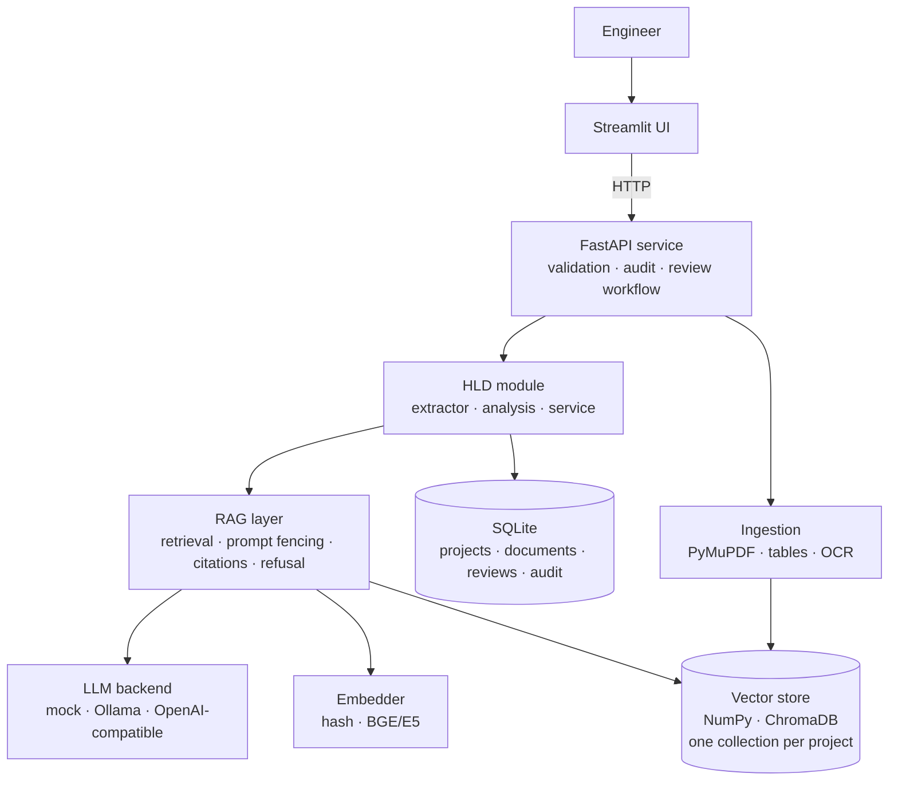

# Automotive Engineering AI Platform

An AI-assisted engineering platform for automotive software teams, built on a shared
**RAG core** (local vector store, pluggable LLM, citations, audit, human review) with
one module per case study:

| # | Module | Status |
|---|--------|--------|
| 1 | **AUTOSAR HLD Document Analysis** | ✅ Implemented (Stage 1) |
| 2 | **Functional Safety HARA & safety requirements** | ✅ Implemented (Stage 2) |
| 3 | **Cybersecurity TARA** | ✅ Implemented (Stage 2) |
| 4 | **UDS diagnostics & test generation** | ✅ Implemented (Stage 3) |
| 5 | Secure code debugging & review | ⬜ Planned (Stage 4) |

> AI output is advisory. Nothing is used for design approval, compliance or release
> without qualified human review. The platform enforces this in the workflow (see *Design decisions*).

## What the HLD module does

- **Controlled ingestion** of PDF / Markdown / text HLDs: type + size validation, SHA-256 de-duplication, version labels, `approved`/`draft` status, optional OCR for scanned pages.
- **Table-aware PDF parsing**: port tables stay attached to the right section (PyMuPDF), so extraction from a PDF equals extraction from the source Markdown (covered by tests).
- **Cited Q&A**: answers carry `[S#]` labels mapped to document, version, page and section. The pipeline **refuses** when evidence is weak instead of guessing.
- **Structured extraction**: components, ports (P/R direction), port interfaces, data elements, signals, runnables, with page-level source references.
- **Dependency graph** (provider → consumer) and **impact analysis** (what breaks downstream if a component changes).
- **Consistency checks** (12 rules, e.g. undefined interface, missing provider, port naming vs direction mismatch, duplicate definitions, interface without type). Findings go to a **review queue**; reviewers mark them *confirmed* or *false positive*, which yields a live precision metric.
- **Revision comparison** (added/removed/changed components, interfaces, ports and which issues were resolved or introduced).
- **Export** to JSON / CSV, **audit log** of every action, **project isolation** (one vector collection per project).

## What the HARA module does (Functional Safety)

Pipeline: **item definition → hazard suggestions → hazardous events → guided S/E/C → deterministic ASIL → safety goals → FSR/TSR drafts → allocation + verification → traceability, completeness, report.**

- **Hazard suggestions** from guidewords × functions, enriched with *similar approved hazards* retrieved from a hazard library (vector search). The library is versioned data with owner and review date; the bundled one is synthetic.
- **Guided assessment**: severity, exposure and controllability each need a **written rationale**. The **ASIL is computed by a rule table, never by the LLM** (`app/modules/hara/rules.py`, `RULESET_VERSION`). Library values are shown as suggestions; the tool records whether the engineer adopted them.
- **Safety goals** are derived from approved events (grouped by function and failure mode, highest ASIL wins). A goal cannot be approved without a safe state and an FTTI.
- **FSR/TSR drafts** from templates with deliberate placeholders (`[FTTI_ms]`, `[SAFE_STATE]`, `[MONITORED_SIGNAL]`). A **requirement quality checker** (shall/atomicity/vague words/placeholders/measurability) **blocks approval** while errors remain.
- **Allocation is validated** against the components extracted from a linked Stage-1 HLD, and every requirement needs a verification reference before approval.
- **Change impact**: reassessing an approved event (e.g. ASIL D → QM) marks its goal and all FSR/TSR **suspect** and records why; goals whose events no longer support them are flagged as orphaned.
- **Completeness**: an 11-point checklist plus a *traceability completeness* percentage over mandatory links; **trace matrix**; Markdown/JSON/CSV **report with approval evidence**.
- **Four-eyes approval** and a **revision history** (who changed what, when) on every record.

## What the TARA module does (Cybersecurity)

Pipeline: **architecture → assets → attack surface / trust boundaries → threat scenarios → impact + attack potential → risk value → treatment → cybersecurity goals → controls/requirements → coverage checklist → traceability.**

- **Inputs**: architecture JSON, **communication-matrix CSV** import (size/row limits, strict validation) or components/flows imported from a Stage-1 HLD; merging never overwrites curated fields.
- **Attack surface map** by interface (CAN, LIN, Ethernet, OBD, USB, Bluetooth/WiFi, cellular/OTA, backend) with exposure class, plus **trust-boundary crossings** between zones.
- **Threat scenarios from an approved library** (STRIDE, damage scenario, high-level attack path, control mapping). Every entry has owner, review date and source; entries **past their review date are flagged** and block the completeness check.
- **Guided risk assessment**: impact per category (safety/financial/operational/privacy) and the five attack-potential factors are chosen by the engineer with a written rationale; **feasibility and risk value are computed by rules** (`app/modules/tara/rules.py`). Optional link to an approved HARA event warns when the TARA safety impact undersells the HARA severity.
- **Treatment**: high risks must be reduced/avoided/shared, or retained with a justification **and a second person's risk acceptance**.
- **Goals and control recommendations** with **source, assumptions and alternatives** on every recommendation; requirement templates carry placeholders that must be resolved before approval.
- **Coverage checklist** (interface × STRIDE) with engineer-justified, approved *not applicable* declarations. The report states explicitly that checklist coverage is not proof of completeness and that expert (red-team) review is required for novel threats.
- Same suspect-propagation, four-eyes, history, trace matrix, metrics (knowledge reuse, acceptance, cycle time, coverage) and report export as HARA.

### Rule sets you must verify

The ASIL table, the attack-potential values, the feasibility thresholds and the risk matrix are implemented as **explicit, versioned example rule sets** (`example-additive-v1`, `example-attack-potential-v1`). They follow the structure of the published methods but you must **check them against your licensed ISO 26262 / ISO/SAE 21434 copy and your organisation's approved method** and change the tables in `rules.py` if they differ. The hazard and threat libraries are **synthetic training data**, not real project knowledge.

## What the UDS module does (Diagnostics)

Pipeline: **diagnostic spec → consistency checks → response oracle → request validation → test generation → review → coverage → simulator → Python/CAPL export.**

- **Specification model** (sessions, security levels, services, DIDs, routines, DTCs, timing) built from a JSON file or **extracted from a Markdown/PDF spec document** (table-aware, same parser as the HLD module; the extraction of the sample spec equals a golden JSON in tests). **Ten consistency rules** on the spec itself (duplicate DIDs, undefined security levels, writable DID without security, DIDs defined but service 0x22 not declared, unmodelled services ...). A spec with errors cannot be approved.
- **One deterministic response oracle** (`engine.py`) predicts the ECU response to any request in any state: NRC 0x11/0x12/0x13/0x24/0x31/0x33/0x35/0x36/0x37/0x7E/0x7F, suppress-positive-response, session changes that lock security access, seed/key sequences with attempt limits and delay, DID and routine rules, write range checks, S3 timeout. The **check order is documented in the file** so it can be aligned with an OEM specification. The LLM never decides an expected result.
- **Request validation**: send one or a sequence of requests (`<KEY>` / `<BADKEY>` markers for key material) and get the expected response, the rule that fired and a plain-language reason.
- **Test generation**: positive, negative, boundary, session, security and timing tests are enumerated from the spec and the **oracle computes every expected result**, so expectations cannot drift from the validation rules. About 118 tests for the sample BCM spec (unlock and lock-out, wrong key, range boundaries, length ±1, session-denied, S3 timeout, TesterPresent keep-alive ...).
- **Review workflow**: tests are proposed, then approved by a second person; tests cannot be approved until the spec is approved. When the spec changes, regenerating **marks changed tests and tests for removed elements suspect** with the reason.
- **Coverage**: every spec element needs a positive and a negative test (attributed by the requests actually sent), plus an **NRC coverage** view (applicable vs exercised).
- **Simulator with fault injection**: a simulated ECU runs the tests without hardware. Seven injectable defects (ignored session restrictions, no security, accept any key, wrong NRC for length errors, ignored suppress bit, no range check, no attempt limit) are **each detected** by the generated suite (asserted in tests), and the correct implementation passes all tests.
- **Export**: a **pytest bundle** (generated tests + standalone stdlib-only `uds_harness.py` + `conftest.py`) and CSV/JSON; an **experimental CAPL** template. Only approved tests are exported unless you ask for a draft. The exported pytest bundle is executed in the test-suite against the simulator (passes on a correct ECU, fails on injected defects).
- **Cross-module traceability**: a test can be attached as verification evidence to a HARA FSR/TSR or a TARA cybersecurity requirement. The shared graph then links hazardous event → goal → requirement → test, so re-assessing the event flags the test evidence for review.
- **Cited Q&A** over the specification document, reusing the shared RAG core.

**What this does not prove:** the simulator shares the oracle with the generator, so passing tests show that the suite and the exported code are consistent and can detect deviations, **not that the specification or the oracle rules are correct**. Verify the oracle's check order and NRC choices against your OEM diagnostic specification (ISO 14229 leaves some choices to the OEM). The CAPL file and the `SocketCanEcu` adapter were **not compiled/run against CANoe or a real bus** here.

## Architecture



```
app/
  config.py            env-driven settings
  container.py         wires shared services (modules plug in here)
  core/                llm · embeddings · vectorstore · parsing · chunking · rag · documents · db
                       trace (traceability graph) · workflow (four-eyes, suspect propagation) · reqquality
  modules/hld/         extractor · analysis · service
  modules/hara/        rules (ASIL) · templates · service
  modules/tara/        rules (risk) · architecture · service
  modules/uds/         spec · engine (oracle) · testgen · simulator · harness_template · export · service   (future: codereview/)
  api/                 main · hld routes · hara · tara · uds · deps
ui/streamlit_app.py    HLD page (main)
ui/pages/              2_Functional_Safety_HARA.py · 3_Cybersecurity_TARA.py · 4_UDS_Diagnostics.py
data/library/          synthetic hazard and threat libraries (versioned, owner + review date)
data/samples/          synthetic BCM HLDs (v1 with planted defects, v2 with fixes), TARA system/comm matrix, UDS spec (md + golden json)
tests/                 158 tests; every store test runs on both NumPy and ChromaDB
```

## Quick start

```bash
python -m venv .venv && source .venv/bin/activate      # Windows: .venv\Scripts\activate
pip install -r requirements-dev.txt
cp .env.example .env                                    # defaults run fully offline

uvicorn app.api.main:app --port 8000                    # terminal 1
python scripts/seed_demo.py                             # optional: loads sample HLDs
streamlit run ui/streamlit_app.py                       # terminal 2  -> http://localhost:8501
```

API docs: http://localhost:8000/docs · Tests: `python -m pytest -q`

### Docker

```bash
cp .env.example .env
docker compose up --build            # UI on :8501, API on :8000
docker compose --profile llm up      # also starts Ollama (then: docker compose exec ollama ollama pull llama3.1:8b)
```

## Using a real LLM and real embeddings

The default `mock` LLM is an extractive stand-in so the whole pipeline runs offline and in CI.
For real answers set in `.env`:

```bash
# Local model with Ollama
ollama pull llama3.1:8b
LLM_BACKEND=ollama  OLLAMA_MODEL=llama3.1:8b

# or any OpenAI-compatible private server (vLLM, LM Studio, llama.cpp, gateway)
LLM_BACKEND=openai_compat  OPENAI_BASE_URL=http://host:8001/v1  OPENAI_MODEL=...

# production-quality retrieval
pip install -r requirements-ml.txt
EMBED_BACKEND=sentence-transformers  EMBED_MODEL=BAAI/bge-small-en-v1.5  VECTOR_BACKEND=chroma
```

After changing the embedding model, re-ingest documents (vectors from different models are not comparable).
With sentence-transformers the refusal threshold defaults to 0.30; tune `MIN_SCORE` on your own questions.

## Design decisions (and why)

1. **Rules first, LLM second, for extraction.** Ports, directions and interfaces feed traceability and consistency checks, so they must be deterministic and auditable. The LLM is used for Q&A and as an opt-in fallback for documents that do not follow the naming taxonomy; its output is tagged `origin: llm` and always reviewed.
2. **Refuse instead of hallucinate.** Retrieval below a similarity threshold, or an LLM reply of `INSUFFICIENT_EVIDENCE`, returns a refusal. Citation labels in the answer are validated against the retrieved evidence (`grounded` flag).
3. **Prompt-injection aware.** Retrieved document text is fenced and declared untrusted in the system prompt.
4. **Only approved documents are searched** by default (stale/draft protection); drafts need an explicit opt-in.
5. **Project isolation** by construction: one vector collection per project and every document route checks project ownership.
6. **Human-in-the-loop is a data model, not a disclaimer.** Findings enter a review queue with reviewer, comment and timestamp; decisions are audited. Reviewer decisions give a measurable *finding precision*, the metric the case study asks for.
7. **Swappable infrastructure behind small interfaces** (`LLM`, `Embedder`, `VectorStore`): NumPy for zero-dependency tests, ChromaDB for the pilot, Milvus/Weaviate can be added without touching modules.
8. **UI ↔ API separation.** Streamlit only calls the REST API, so an enterprise portal or CI job can reuse the same backend.
9. **Section-aware chunking** with breadcrumbs (`3 Software Components > 3.1 SWC_X`) so retrieved chunks carry their architectural context and citations point to a real section and page.

## Risk controls (from the case study)

| Risk | Control in this codebase |
|---|---|
| Incorrect extraction from tables/diagrams | Page-level source refs; review queue; PDF↔MD parity tests |
| Hallucinated relationships | Extraction is rule-based; Q&A refuses on weak evidence; citation validation |
| Unauthorized access across programs | Per-project collections + ownership checks (RBAC/IAM is Stage 5) |
| Outdated document versions | Version labels, approved-only search, checksum de-duplication |

## Testing

`python -m pytest -q` runs 158 tests. Stage 1:  chunking, both vector backends, extraction (MD and PDF), every consistency rule on planted defects, impact analysis, revision diff, API flow (upload validation, Q&A, refusal, draft gating, project isolation, review workflow, audit, delete). Stage 2: ASIL corner cases, requirement-quality rules, four-eyes enforcement, approval gates, idempotent generation, change-impact suspect propagation, allocation checks against the linked HLD, HARA↔TARA safety-link consistency, coverage checklist and N/A flow, stale-library detection, CSV/HLD imports, reports, history and project isolation. Stage 3: spec normalisation and extraction (golden file), spec consistency rules, oracle behaviour per service (check order, security flow, S3, ranges, suppress bit), deterministic generation with oracle-consistency check, defect detection for every injected fault, exported bundle executed under pytest, spec-change suspect propagation, requirement links across modules, coverage and NRC coverage.

**Verified in development:** the full automated suite, plus the Streamlit UI driven headlessly (Streamlit `AppTest`) against a live API.
**Not verified here:** a real LLM (Ollama/vLLM), sentence-transformers embeddings, and the Docker build. Run these once on your machine before a demo.

## Known limitations

- Heading detection in PDFs is text-pattern based (numbered/`#` headings); documents with unusual layouts may need a taxonomy tweak in `Taxonomy` (`extractor.py`).
- Diagrams inside PDFs are not interpreted (only text/tables/OCR).
- Authentication is a header (`X-User`) for audit attribution only; real IAM/RBAC is a Stage-5 item.
- Sample documents and both libraries are synthetic. No licensed standards text is included.
- Library retrieval with the offline hash embedder is lexical and can surface loosely related entries; use BGE/E5 embeddings for better similarity. Similar hazards are always shown as suggestions, never applied automatically.
- TARA threat generation is taxonomy-driven (asset kind × interface). Anything the library does not cover is reported (*assets without threats*, coverage gaps) rather than invented.
- The UDS oracle models ten services (0x10, 0x11, 0x14, 0x19, 0x22, 0x27, 0x2E, 0x31, 0x3E, 0x85). Other services listed in a spec are flagged *unmodelled* and get no tests; memory/transfer services, functional addressing, ISO-TP and CAN timing are out of scope.
- Authoring of full safety cases, diagram interpretation and formal FMEA/FTA are out of scope.

## Roadmap

- [x] Stage 1: shared core + HLD module
- [x] Stage 2: HARA (deterministic S/E/C→ASIL, safety goals, FSR/TSR drafts, allocation, change impact) and TARA (assets, attack surface, threat library, risk, controls, coverage)
- [x] Stage 3: UDS (spec extraction, response oracle, request validation, test generation, simulator with fault injection, Python/CAPL export)
- [ ] Stage 4: Secure code review (MISRA-style checks, static-analysis log ingestion)
- [ ] Stage 5: traceability graph, RBAC, observability, packaging
