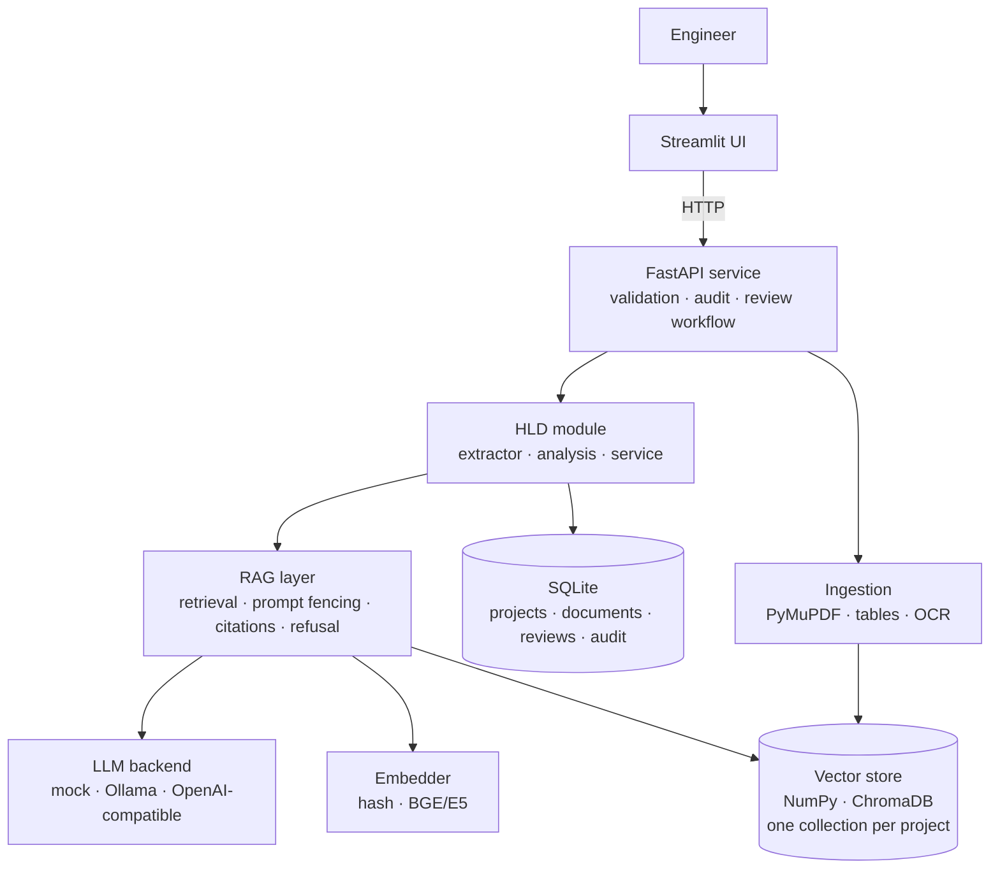

# Automotive Engineering AI Platform

An AI-assisted engineering platform for automotive software teams, built on a shared
**RAG core** (local vector store, pluggable LLM, citations, audit, human review) with
one module per case study:

| # | Module | Status |
|---|--------|--------|
| 1 | **AUTOSAR HLD Document Analysis** | ✅ Implemented (Stage 1) |
| 2 | Functional Safety HARA & safety requirements | ⬜ Planned (Stage 2) |
| 3 | Cybersecurity TARA | ⬜ Planned (Stage 2) |
| 4 | UDS diagnostics & test generation | ⬜ Planned (Stage 3) |
| 5 | Secure code debugging & review | ⬜ Planned (Stage 4) |

> AI output is advisory. Nothing is used for design approval, compliance or release
> without qualified human review. The platform enforces this in the workflow (see *Design decisions*).

## What the HLD module does

- **Controlled ingestion** of PDF / Markdown / text HLDs: type + size validation, SHA-256 de-duplication, version labels, `approved`/`draft` status, optional OCR for scanned pages.
- **Table-aware PDF parsing**: port tables stay attached to the right section (PyMuPDF), so extraction from a PDF equals extraction from the source Markdown (covered by tests).
- **Cited Q&A**: answers carry `[S#]` labels mapped to document, version, page and section. The pipeline **refuses** when evidence is weak instead of guessing.
- **Structured extraction**: components, ports (P/R direction), port interfaces, data elements, signals, runnables, with page-level source references.
- **Dependency graph** (provider → consumer) and **impact analysis** (what breaks downstream if a component changes).
- **Consistency checks** (12 rules, e.g. undefined interface, missing provider, port naming vs direction mismatch, duplicate definitions, interface without type). Findings go to a **review queue**; reviewers mark them *confirmed* or *false positive*, which yields a live precision metric.
- **Revision comparison** (added/removed/changed components, interfaces, ports and which issues were resolved or introduced).
- **Export** to JSON / CSV, **audit log** of every action, **project isolation** (one vector collection per project).

## Architecture



```
app/
  config.py            env-driven settings
  container.py         wires shared services (modules plug in here)
  core/                llm · embeddings · vectorstore · parsing · chunking · rag · documents · db
  modules/hld/         extractor · analysis · service        (future: hara/ tara/ uds/ codereview/)
  api/main.py          FastAPI routes
ui/streamlit_app.py    engineering UI
data/samples/          synthetic BCM HLDs (v1 with planted defects, v2 with fixes) in .md and .pdf
tests/                 48 tests; every store test runs on both NumPy and ChromaDB
```

## Quick start

```bash
python -m venv .venv && source .venv/bin/activate      # Windows: .venv\Scripts\activate
pip install -r requirements-dev.txt
cp .env.example .env                                    # defaults run fully offline

uvicorn app.api.main:app --port 8000                    # terminal 1
python scripts/seed_demo.py                             # optional: loads sample HLDs
streamlit run ui/streamlit_app.py                       # terminal 2  -> http://localhost:8501
```

API docs: http://localhost:8000/docs · Tests: `python -m pytest -q`

### Docker

```bash
cp .env.example .env
docker compose up --build            # UI on :8501, API on :8000
docker compose --profile llm up      # also starts Ollama (then: docker compose exec ollama ollama pull llama3.1:8b)
```

## Using a real LLM and real embeddings

The default `mock` LLM is an extractive stand-in so the whole pipeline runs offline and in CI.
For real answers set in `.env`:

```bash
# Local model with Ollama
ollama pull llama3.1:8b
LLM_BACKEND=ollama  OLLAMA_MODEL=llama3.1:8b

# or any OpenAI-compatible private server (vLLM, LM Studio, llama.cpp, gateway)
LLM_BACKEND=openai_compat  OPENAI_BASE_URL=http://host:8001/v1  OPENAI_MODEL=...

# production-quality retrieval
pip install -r requirements-ml.txt
EMBED_BACKEND=sentence-transformers  EMBED_MODEL=BAAI/bge-small-en-v1.5  VECTOR_BACKEND=chroma
```

After changing the embedding model, re-ingest documents (vectors from different models are not comparable).
With sentence-transformers the refusal threshold defaults to 0.30; tune `MIN_SCORE` on your own questions.

## Design decisions (and why)

1. **Rules first, LLM second, for extraction.** Ports, directions and interfaces feed traceability and consistency checks, so they must be deterministic and auditable. The LLM is used for Q&A and as an opt-in fallback for documents that do not follow the naming taxonomy; its output is tagged `origin: llm` and always reviewed.
2. **Refuse instead of hallucinate.** Retrieval below a similarity threshold, or an LLM reply of `INSUFFICIENT_EVIDENCE`, returns a refusal. Citation labels in the answer are validated against the retrieved evidence (`grounded` flag).
3. **Prompt-injection aware.** Retrieved document text is fenced and declared untrusted in the system prompt.
4. **Only approved documents are searched** by default (stale/draft protection); drafts need an explicit opt-in.
5. **Project isolation** by construction: one vector collection per project and every document route checks project ownership.
6. **Human-in-the-loop is a data model, not a disclaimer.** Findings enter a review queue with reviewer, comment and timestamp; decisions are audited. Reviewer decisions give a measurable *finding precision*, the metric the case study asks for.
7. **Swappable infrastructure behind small interfaces** (`LLM`, `Embedder`, `VectorStore`): NumPy for zero-dependency tests, ChromaDB for the pilot, Milvus/Weaviate can be added without touching modules.
8. **UI ↔ API separation.** Streamlit only calls the REST API, so an enterprise portal or CI job can reuse the same backend.
9. **Section-aware chunking** with breadcrumbs (`3 Software Components > 3.1 SWC_X`) so retrieved chunks carry their architectural context and citations point to a real section and page.

## Risk controls (from the case study)

| Risk | Control in this codebase |
|---|---|
| Incorrect extraction from tables/diagrams | Page-level source refs; review queue; PDF↔MD parity tests |
| Hallucinated relationships | Extraction is rule-based; Q&A refuses on weak evidence; citation validation |
| Unauthorized access across programs | Per-project collections + ownership checks (RBAC/IAM is Stage 5) |
| Outdated document versions | Version labels, approved-only search, checksum de-duplication |

## Testing

`python -m pytest -q` runs 48 tests: chunking, both vector backends, extraction (MD and PDF), every consistency rule on planted defects, impact analysis, revision diff, API flow (upload validation, Q&A, refusal, draft gating, project isolation, review workflow, audit, delete).

**Verified in development:** the full automated suite, plus the Streamlit UI driven headlessly (Streamlit `AppTest`) against a live API.
**Not verified here:** a real LLM (Ollama/vLLM), sentence-transformers embeddings, and the Docker build. Run these once on your machine before a demo.

## Known limitations

- Heading detection in PDFs is text-pattern based (numbered/`#` headings); documents with unusual layouts may need a taxonomy tweak in `Taxonomy` (`extractor.py`).
- Diagrams inside PDFs are not interpreted (only text/tables/OCR).
- Authentication is a header (`X-User`) for audit attribution only; real IAM/RBAC is a Stage-5 item.
- Sample documents are synthetic. No licensed standards text is included.

## Roadmap

- [x] Stage 1: shared core + HLD module
- [ ] Stage 2: HARA (deterministic S/E/C→ASIL table, safety goals/FSR/TSR drafts) and TARA (assets, attack surfaces, threat library)
- [ ] Stage 3: UDS (request validation, positive/negative test generation, Python/CAPL export)
- [ ] Stage 4: Secure code review (MISRA-style checks, static-analysis log ingestion)
- [ ] Stage 5: traceability graph, RBAC, observability, packaging
